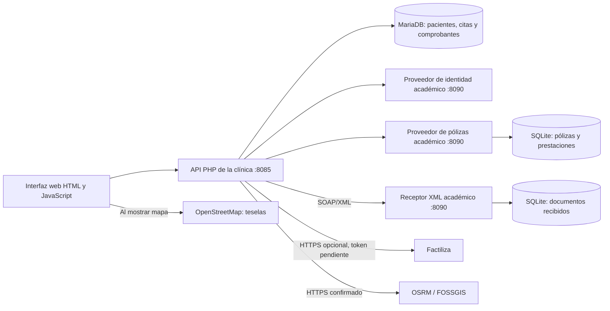

# Implementación integrada — estado verificable

Esta guía reemplaza las descripciones de alcance de los incrementos iniciales. No implica conexión oficial a RENIEC, aseguradoras ni SUNAT.

## Arquitectura implementada

El proceso del proveedor es independiente del servidor de la clínica. Comparte el equipo para reducir costos de despliegue, pero recibe solicitudes HTTP autenticadas con una credencial de servicio. Las respuestas incluyen transporte, destino, código del proveedor y duración. No se exponen tokens. S05 muestra además XML enviado y recibido; el receptor conserva su propio registro de documento e importe.

## Contratos y responsabilidades

| Servicio | Operación y formato | Estado |
|---|---|---|
| S01 | POST identidad.php, JSON; proveedor=academico o factiliza | Académico verificado. Factiliza configurado en código conforme a su documentación; falta token y prueba externa. |
| S02 | POST seguros.php, JSON con dni, aseguradora y tipoAtencion | Consulta pólizas persistentes por HTTP; vigencia por fechas y copagos calculados. |
| S03 | GET sedes.php; ruta=1 con origen consulta OSRM HTTPS | Catálogo de ubicaciones de prueba y rutas externas verificadas. Leaflet local para mapa. |
| S04 | POST admision.php con doctor_id, fecha, hora, motivo, idSede, modalidad | Fachada de flujo integrado; preserva API de reserva independiente para pruebas. |
| S05 | POST comprobantes.php con idCita; GET para consultar | Genera documento, transmite XML, valida respuesta y conserva un registro por cita. |

## Control del proceso

S01 guarda temporalmente el DNI consultado, procedencia y hora en la sesión. Una nueva consulta invalida la identidad/cobertura anteriores, incluso si falla. S02 guarda temporalmente la decisión para un DNI y prestación. La fachada admision.php exige ambos resultados recientes (10 minutos), mismo DNI, prestación del médico y sede habilitada. Para modalidad seguro se exige cobertura aprobada; particular es una elección explícita del paciente.

La reserva y `cita_contexto` se guardan en una transacción. El contexto contiene sede, modalidad, tarifa, importe del paciente y procedencia de identidad; no copia el DNI a la tabla de contexto. La factura usa ese importe guardado, no el enviado por el navegador. Las citas antiguas o creadas mediante la API S04 independiente siguen usando tarifa particular de demostración y no se alteran retroactivamente.

La sede se guarda como atributo de admisión; no hay una agenda médica separada por sede. El mismo turno de un médico sigue siendo único en toda la clínica. Los resultados de S01 son consulta documental, no verificación de titularidad. La cuenta autenticada y la identidad consultada permanecen diferenciadas; usar datos académicos para las pruebas.

## Proveedores y diferencias con APF2

- Identidad: proveedor académico sintético o Factiliza como intermediario, nunca presentado como RENIEC directo. Factiliza no se activa sin credencial. No se recopilan dirección ni otros atributos no necesarios de su respuesta.
- Seguros: proveedor propio de laboratorio con base independiente; no SIS, EPS ni aseguradora comercial. `proveedor-seguros.sqlite` contiene fechas y prestaciones. Los datos son sintéticos pero la consulta y evaluación son funcionales.
- Ubicación: Google Maps se sustituye funcionalmente por Leaflet/OpenStreetMap y OSRM. No se llama a Google Maps API. El enlace externo a un mapa no se considera evidencia de consumo de rutas; la evidencia es la respuesta HTTPS OSRM.
- Citas: servicio interno con persistencia real.
- Facturación: receptor propio de XML; no SUNAT beta ni producción. Los estados conservan sufijo SIMULADO para identificar el entorno académico. La validación normal comprueba estructura, campos, importe positivo y código; los escenarios de rechazo/indisponibilidad quedan en herramientas avanzadas. No hay XML UBL, firma digital ni comprobante tributario.

## Pruebas y evidencias

Las suites S01, S02, S03, S04 y S05 pasaron tras los cambios. La suite integrada realizó 15 comprobaciones con creación/limpieza de usuarios temporales: bloqueo sin identidad, especialidad inconsistente, reserva con copago, envío XML y atención particular ante seguro vencido. Se comprobó también que Factiliza sin token no devuelva identidades inventadas. La conectividad a OSRM devolvió HTTP 200, con destino y tiempos registrados.

La evidencia JSON se encuentra en `tests/`. No se ha realizado una captura visual nueva en esta versión: la herramienta de escritorio se detuvo al no poder verificar con certeza la URL del navegador. Esto no afecta a las pruebas HTTP; el mapa Leaflet y el flujo de pantalla requieren comprobación visual manual. No se afirmará que una captura antigua evidencia los cambios nuevos.

## Seguridad y límites

Sesión PHP, CSRF en operaciones de cambio, consultas preparadas, autorización de recursos propios, tokens del proveedor fuera de la raíz web, validación TLS en conexiones externas y parsers XML sin entidades externas/DOCTYPE. El proveedor académico escucha solo en localhost. El servidor de desarrollo local continúa usando HTTP, por lo que HTTPS de extremo a extremo está pendiente. No hay cargos ni contratación automatizada. El presupuesto local de Factiliza limita a 80 llamadas por mes, sin conocer el consumo fuera del proyecto.

No equivalen a cumplimiento de producción: faltan permisos de emisión institucional, ESB del diseño, roles de Caja, verificación de titularidad y otros controles avanzados. Los apartados BPM, B2B y diagramas del informe deben describir estos componentes y separar propuesta de implementación.

## Fuentes técnicas

- Factiliza DNI: https://docs.factiliza.com/api-consulta/endpoint/dni
- Plan gratuito publicado: https://factiliza.com/api-consulta
- OSRM API: https://project-osrm.org/docs/v5.24.0/api/
- Servidor OSRM/FOSSGIS y condiciones: https://routing.openstreetmap.de/about.html
- Leaflet: https://leafletjs.com/
- Teselas OpenStreetMap: https://operations.osmfoundation.org/policies/tiles/
